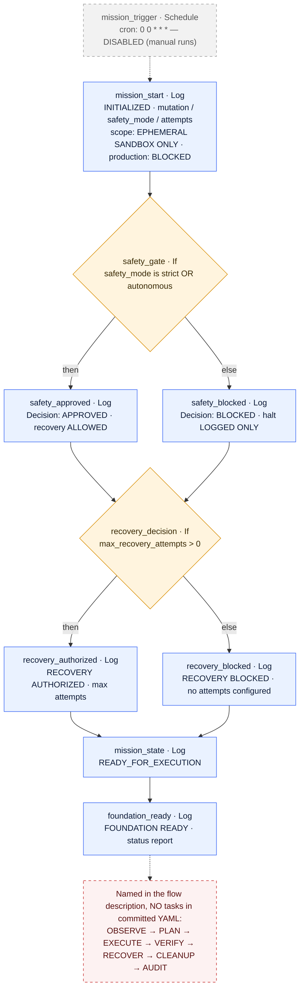

# Mutant AI — Autonomous Infrastructure Resilience Engine

### Mutate. Gate. Recover. Verify. Prove — as a single reusable Kestra flow.


**Mutant AI** is an open-source **Kestra Blueprint** for autonomous infrastructure resilience missions: one declarative flow that accepts a mutation scenario and a recovery policy, passes both through deterministic safety gates, authorizes bounded recovery, and records an ordered mission audit — inside an explicitly sandboxed scope.

> **The premise:** detection without a bounded, auditable response plan is just a faster way to learn you are broken. Mutant AI encodes the response plan as reviewable YAML — policy gates first, actions second, evidence always.

**What it does today.** The committed flow (`blueprint.mutant_ai::mutant_ai_autonomous_resilience`) implements the mission controller: initialization with scope declaration, a policy safety gate on `safety_mode`, a recovery-authorization gate on `max_recovery_attempts`, mission-state transition, and a foundation-status report — all with Kestra core plugins, zero credentials, zero external services.

> [!IMPORTANT]
> **Read this before adopting anything below.**
> Two sources of truth exist in this repository, and they do not fully agree:
> 1. **The committed YAML** ([`flows/mutant-ai-autonomous-resilience.yaml`](flows/mutant-ai-autonomous-resilience.yaml)) defines **5 root tasks + 4 branch tasks**, all `Log`/`If` core tasks. It is the only implementation anyone can review, import, and reproduce from this repo.
> 2. **A maintainer-reported sandbox execution** on a working Kestra instance shows **32 succeeded tasks in 25.05 s** with a `disk_pressure` scenario, rollback, verification, cleanup, a `MISSION_COMPLETE` status, a 92/100 resilience score, and KV Store mission-history keys. That richer task graph is **not present in the committed YAML**, so those runtime results **cannot be reproduced or audited from this repository today**.
> This README documents the committed implementation precisely, reports the execution evidence with explicit verification status, and treats the source-vs-deployment gap as a first-class [submission-readiness gap](#hacktoberfest-2026-track-2--submission-readiness). Nothing here claims production remediation, LLM reasoning, or official endorsement.

### Blueprint at a glance

| | |
|---|---|
| **Flow ID** | `blueprint.mutant_ai::mutant_ai_autonomous_resilience` |
| **Source** | [`flows/mutant-ai-autonomous-resilience.yaml`](flows/mutant-ai-autonomous-resilience.yaml) — single file, no dependencies |
| **Committed task graph** | 5 root tasks (`mission_start`, `safety_gate`, `recovery_decision`, `mission_state`, `foundation_ready`) + 4 conditional branch tasks; a default run executes 7 tasks |
| **Inputs** | `mutation` (STRING), `safety_mode` (STRING), `max_recovery_attempts` (INT) |
| **Trigger** | `mission_trigger` — daily `Schedule` (`0 0 * * *`), **`disabled: true`** (manual runs by default) |
| **Plugins** | Kestra core only (`io.kestra.plugin.core.log.Log`, `io.kestra.plugin.core.flow.If`, `io.kestra.plugin.core.trigger.Schedule`) |
| **Credentials** | None — no secrets, no cloud APIs, no shell commands, no infrastructure access |
| **Scope** | Log-only sandbox simulation — production access is declared blocked by policy |

---

## Table of Contents

- [The Problem](#the-problem)
- [What Mutant AI Does Today](#what-mutant-ai-does-today)
- [Architecture](#architecture)
- [Autonomy and Safety](#autonomy-and-safety)
- [Execution Evidence](#execution-evidence)
- [Hacktoberfest 2026 Track 2 — Submission Readiness](#hacktoberfest-2026-track-2--submission-readiness)
- [Prerequisites](#prerequisites)
- [Installation and Quick Start](#installation-and-quick-start)
- [Configuration Reference](#configuration-reference)
- [Inspecting Results](#inspecting-results)
- [Example Output](#example-output)
- [Failure Modes and Troubleshooting](#failure-modes-and-troubleshooting)
- [Limitations and Roadmap](#limitations-and-roadmap)
- [Contributing](#contributing)
- [License and Acknowledgments](#license-and-acknowledgments)

---

## The Problem

Monitoring catches fires. Most automation pours gasoline: an unattended script that retries forever, remediates the wrong thing, or "fixes" production without a verification step or an audit trail.

A resilience workflow you can actually trust must answer five questions **before** it touches anything:

| Question | Why it matters |
|---|---|
| **Is the action authorized?** | A remediation loop without a policy gate is an outage generator. |
| **Is the blast radius bounded?** | Recovery attempts must be capped by reviewed configuration, not hope. |
| **Was the outcome verified?** | "The command exited 0" and "the system recovered" are different facts. |
| **Was the state cleaned up?** | Residual mutation is debt that compounds into the next incident. |
| **Can I prove what happened?** | Post-incident review needs durable, ordered evidence. |

Mutant AI's design answer: encode every one of those gates **declaratively**, so another engineer can read the control flow — and its limits — before they ever run it.

---

## What Mutant AI Does Today

The committed flow is a **mission controller skeleton**: a strict, linear, deterministic control path with two real policy decisions.

- **Policy gates are tasks, not documentation.** `safety_gate` and `recovery_decision` are `io.kestra.plugin.core.flow.If` tasks. An unapproved `safety_mode` is routed to a blocked branch before recovery authorization is even evaluated.
- **Bounded by construction.** Recovery authorization derives from an input (`max_recovery_attempts`), so the retry envelope is a reviewed configuration value — not a hard-coded loop.
- **Sandbox-scoped by policy.** Every gate message declares `EPHEMERAL SANDBOX ONLY`, `Production access: BLOCKED`, and `Destructive production actions: BLOCKED`.
- **Zero dependencies.** Core Kestra plugins only — import the single YAML into any Kestra instance and run. No community plugins, no credentials, no external services, no secrets in source control.
- **Evidence-first.** Every task writes structured, ordered log text; Kestra retains it with the execution as the mission's audit chain.

What it deliberately does **not** do yet — run chaos mutations, inspect telemetry, heal anything, verify recovery, clean up artifacts, score missions, or persist to KV Store — is documented in [Limitations and Roadmap](#limitations-and-roadmap) rather than implied.

---

## Architecture

The diagram below is generated from the **actual task graph in the committed YAML**. Root tasks execute sequentially; each `If` task contributes one branch child to the run.



**Reading the diagram**

- **Blue** — `Log` tasks; they produce the mission's ordered execution evidence.
- **Amber** — deterministic policy decisions (`If`); no probabilistic component anywhere.
- **Grey dashed** — the schedule trigger exists but is `disabled: true`; runs are manual by default.
- **Red dashed** — lifecycle stages named in the flow `description` with **no corresponding task** in the committed YAML. They describe the target mission shape, not the shipped implementation.

**Declared vs. executed:** on a default run, Kestra executes 7 tasks (`mission_start` → `safety_gate` → `safety_approved` → `recovery_decision` → `recovery_authorized` → `mission_state` → `foundation_ready`). The blocked branches substitute for their approved counterparts; either way the run **finishes successfully**, because both `else` branches only log.

---

## Autonomy and Safety

### What is genuinely automated

| Mechanism | Implementation in the committed YAML | Status |
|---|---|---|
| Mission initialization & scope declaration | `mission_start` echoes all inputs plus sandbox/production policy banner | **Implemented** (log-level) |
| Safety policy gate | `safety_gate` `If`: `safety_mode` ∈ {`strict`, `autonomous`} | **Implemented** — routes to approved/blocked branch |
| Recovery authorization gate | `recovery_decision` `If`: `max_recovery_attempts > 0` | **Implemented** — routes to authorized/blocked branch |
| Mission state transition | `mission_state` logs `READY_FOR_EXECUTION` | **Implemented** (textual state only) |
| Foundation status report | `foundation_ready` logs end-of-mission status | **Implemented** |
| Scheduled triggering | `mission_trigger` daily cron | **Implemented but `disabled: true`** |
| Mutation execution, telemetry, detection | — | Not in committed YAML |
| Retry / rollback constructs | — | Policy gate only; no retry loop exists |
| Verification, cleanup, audit hashing | — | Not in committed YAML |
| Scoring & KV Store persistence | — | Not in committed YAML |

### What "autonomous" and "AI" mean here

> [!NOTE]
> **This is deterministic workflow logic, not machine learning.** The committed flow contains no model inference, no prompts, no AI-provider integration, and no `ai`-plugin tasks. Every decision is an `If` condition over flow inputs. The "AI" in the project name is the product vision; the shipped artifact is a reviewable, testable, reproducible policy skeleton. The maintainer-reported 32-task execution likewise describes deterministic task logic — do not read it as an LLM-powered agent.

### What recovery and rollback mean in this simulation

- **In the committed YAML:** "recovery" is a *policy decision*. `recovery_authorized` records that autonomous recovery was authorized up to `max_recovery_attempts`; no retry, no remediation action, no rollback is executed. `recovery_blocked` merely logs the refusal.
- **In the reported sandbox execution:** rollback and verification were reported as `True` for a `disk_pressure` scenario. Those are **simulated workflow states** in a controlled sandbox — they are not evidence that any real infrastructure was mutated, healed, or rolled back. See [Execution Evidence](#execution-evidence).

### What safety gates actually enforce vs. merely log

| Control | Enforced? | Reality |
|---|---|---|
| Approved-only `safety_mode` for the approved branch | **Yes** — branch selection is enforced by the `If` task | Only `strict`/`autonomous` reach `safety_approved` |
| "Mission halted" on the blocked path | **No — logs only** | `safety_blocked` prints "Mission halted before infrastructure mutation", but the flow continues to `recovery_decision` and ends `FOUNDATION READY`. A hard halt requires a `Fail`/`Kill` task in the `else` branch (roadmap item). |
| Production isolation | **Policy-level declaration only** | The flow performs no shell commands, no cloud API calls, no file writes, no container operations. It cannot touch production because it performs no actions at all — but the banner text itself enforces nothing. |
| Bounded recovery attempts | **Config-level only** | The bound is an input; no retry construct consumes it yet. |
| Secrets hygiene | **By construction** | No credentials, tokens, or keystores required or committed. |
| Cryptographic evidence signing | **Not implemented — none claimed** | The flow performs no hashing and no signing. A future workflow-computed digest would be an *integrity checksum*, not a digital signature (no private key, no authorship proof). |

**Human review boundaries today:** enabling the schedule, changing gate conditions, and any future extension that adds real actions all require human review. Nothing in this flow should be wired to production without an enforcing halt, real verification, and an owner-approved change.

---

## Execution Evidence

Two tiers of evidence exist. Both are reported honestly; neither is overclaimed.

### Tier 1 — Reproducible from this repository (committed YAML)

Any engineer can import the flow and reproduce the foundation run in minutes: 7 succeeded tasks on the default path, ordered logs from `mission_start` through `FOUNDATION READY`, branch behavior verifiable by changing `safety_mode` or `max_recovery_attempts`. See [Example Output](#example-output).

### Tier 2 — Maintainer-reported sandbox execution (not reproducible from committed source)

The following results were reported from a working Kestra instance running a sandbox simulation:

| Reported result | Value | Verification status |
|---|---|---|
| Succeeded tasks | 32 | **Unreproducible from committed YAML** — the committed flow declares 9 task definitions (7 executed per run) |
| Duration | 25.05 s | Reported; not independently verified |
| Mutation scenario | `disk_pressure` | Plausible as an input value; no `disk_pressure` logic exists in committed YAML |
| Recovery attempts | 3 | Consistent with `max_recovery_attempts: 3` policy gate |
| Rollback | `True` | No rollback construct exists in committed YAML |
| Recovery verification | `True` | No verification task exists in committed YAML |
| Final mission status | `MISSION_COMPLETE` | Token does not appear in committed YAML (terminal message there is `FOUNDATION READY`) |
| Cleanup | `True` | No cleanup task exists in committed YAML |
| Resilience score | 92/100 | No scoring task exists in committed YAML |
| Mission history | KV Store keys visible | No KV Store usage exists in committed YAML |

> [!WARNING]
> **Source-to-deployment drift is an open gap.** The reported 32-task graph evidently lives (or lived) on the maintainer's Kestra instance but was never committed to this repository. Until the deployed definition is committed and reviewable, Tier 2 results are **reported, not verifiable** — and this README will not present them as the shipped implementation. Closing this gap is the top roadmap item.

**What the reported results do not prove:** real production infrastructure was inspected, mutated, repaired, rolled back, or healed. All reported behavior is a controlled workflow simulation whose actions are task-state transitions and logs.

---

## Hacktoberfest 2026 Track 2 — Submission Readiness

This project **targets** Kestra's [Hacktoberfest 2026](https://kestra.io/hacktober) **Track 2 — "Build a Flow Other People Will Reuse"** ([blueprints catalog](https://github.com/kestra-io/blueprints)). It has **not** been submitted, accepted, merged, sponsored, or endorsed; nothing here implies official approval.

Criteria verified against the official track page and the committed YAML:

| Official Track 2 criterion | Status in this repository |
|---|---|
| Minimum 3 runnable tasks | **Met** — 5 root tasks + 4 branch tasks committed |
| At least 1 flowable task (`If` / parallel / loop) | **Met** — two `If` tasks (`safety_gate`, `recovery_decision`) |
| At least 1 trigger | **Met** — `mission_trigger` Schedule (disabled by default; enable deliberately) |
| At least 1 **non-core plugin** | **Not met — submission-readiness gap.** The committed flow uses only `io.kestra.plugin.core.*` tasks. A qualifying submission needs at least one non-core plugin integration (e.g., real telemetry, storage, or notification). |
| Submitted as a merged PR to `kestra-io/blueprints` | **Pending** — no PR is claimed |
| Blueprint catalog metadata (`extend` block) | **Missing** — the catalog expects `extend` metadata (title, description, tags, `metaDescription`); the committed YAML has none |

Additional gaps a catalog reviewer would flag: the deployed-vs-committed drift described above, the non-enforcing safety halt, and the absent `LICENSE` file. All are tracked in [Limitations and Roadmap](#limitations-and-roadmap).

---

## Prerequisites

| Requirement | Detail | Verified? |
|---|---|---|
| Kestra instance | Running Kestra server (UI + API) | Required for any run |
| Core plugin tasks | `Log`, `If`, `Schedule` under `io.kestra.plugin.core.*` | Bundled with Kestra core — no plugin install needed |
| Minimum Kestra version | Not pinned in this repository | **Unverified** — validate the flow syntax on your version before adoption |
| Permissions | Create/edit + execute flows in `blueprint.mutant_ai` (or your own namespace) | Depends on your Kestra RBAC |
| External plugins | None for the committed flow | Verified from YAML |
| Credentials / secrets | None | Verified from YAML |
| Docker / infrastructure access | Not required; the flow touches nothing outside Kestra's execution log | Verified from YAML |

---

## Installation and Quick Start

**1. Get the flow file**

```bash
git clone <your-fork-or-source-url>   # placeholder — replace with the actual repository URL
cd mutant-ai
# the only runtime artifact: flows/mutant-ai-autonomous-resilience.yaml
```

**2. Import into Kestra**

Kestra UI → **Flows → Create → Import from repository / upload file** → select `flows/mutant-ai-autonomous-resilience.yaml` (or paste its contents into the flow editor). If you use Kestra's Git storage integration, point it at the `flows/` directory instead.

**3. Keep or change the namespace**

The flow declares `namespace: blueprint.mutant_ai`. Keep it, or edit `namespace` to match your organization before importing.

**4. Review the inputs**

The execution form pre-fills: `mutation = network_latency`, `safety_mode = strict`, `max_recovery_attempts = 3`. See [Configuration Reference](#configuration-reference).

**5. Validate and execute**

Save the flow, confirm Kestra's validation panel is clean, then **Execute** with defaults.

**6. Triggering — safely default-off**

- **Default:** `mission_trigger` is `disabled: true` → manual execution only. This is the intended starting point.
- **Scheduled:** set `disabled: false` for a daily run at `0 0 * * *` (no `timezone` key is set; the schedule follows your Kestra instance default — verify it).
- **API / webhook:** the flow defines **no webhook trigger**. For remote execution, use your Kestra version's authenticated execution endpoint with an API key stored in Kestra's secret storage — **never** embed keys in the flow YAML or in this README.

**7. Inspect the run**

**Executions → your run → Logs.** Each executed task writes one ordered, human-readable record. See [Inspecting Results](#inspecting-results).

---

## Configuration Reference

### Inputs

| Input | Type | Default | Consumed by | Notes |
|---|---|---|---|---|
| `mutation` | `STRING` | `network_latency` | `mission_start` (log echo only) | Declared fault class. No task validates or acts on it. The reported sandbox run used `disk_pressure`. |
| `safety_mode` | `STRING` | `strict` | `safety_gate` condition | `strict` or `autonomous` → approved branch; **any other value** → blocked branch. Not enforced as an enum. |
| `max_recovery_attempts` | `INT` | `3` | `recovery_decision` condition | `> 0` → authorized; `0` or negative → blocked. Not yet bound to a retry construct. |

### Triggers

| Trigger ID | Type | Cron | State | Notes |
|---|---|---|---|---|
| `mission_trigger` | `io.kestra.plugin.core.trigger.Schedule` | `0 0 * * *` (daily) | **`disabled: true`** | Optional unattended cadence; off by default. No `timezone` key in the flow. |

### Flow metadata

| Field | Value |
|---|---|
| Flow ID | `mutant_ai_autonomous_resilience` |
| Namespace | `blueprint.mutant_ai` |
| Root tasks | `mission_start`, `safety_gate`, `recovery_decision`, `mission_state`, `foundation_ready` |
| Branch tasks | `safety_approved` / `safety_blocked`, `recovery_authorized` / `recovery_blocked` |
| `outputs:` block | None |
| `errors` / `retries` / `finally` blocks | None |
| Secrets referenced | None |

---

## Inspecting Results

**The committed flow defines no `outputs:` block** — no JSON artifacts, no emitted files, no KV Store writes. All committed-source evidence is structured task-log text retained by Kestra with the execution.

| Evidence | Where to find it | What it shows |
|---|---|---|
| Mission plan record | `mission_start` log | Inputs used, declared sandbox scope, production access declared blocked |
| Safety decision | `safety_approved` / `safety_blocked` log | Which gate branch ran and why |
| Recovery policy decision | `recovery_authorized` / `recovery_blocked` log | Whether recovery was authorized and the configured bound |
| State + completion | `mission_state`, `foundation_ready` logs | `READY_FOR_EXECUTION` → `FOUNDATION READY` |
| Run history | Kestra **Executions** list for the namespace | Every past run, per your instance's retention configuration |
| KV Store mission history | **Not written by the committed flow** | The maintainer-reported run showed KV keys; that behavior is absent from committed source |

Four statuses that are **not** interchangeable:

| Status | Meaning | Present here? |
|---|---|---|
| Kestra execution success | All executed tasks completed — note the *blocked* path also finishes **successfully**, because it only logs | Yes — expected on every run today |
| Mission-level `MISSION_COMPLETE` | Terminal mission marker | **Reported** in the maintainer sandbox run; **not** in committed YAML (which ends at `FOUNDATION READY`) |
| Resilience score (e.g. 92/100) | Composite mission score | **Reported** in the maintainer sandbox run; **no scoring task** in committed YAML |
| Official acceptance | Kestra / Hacktoberfest endorsement | **No** — nothing here implies it |

---

## Example Output

> The log block below is **illustrative**, derived deterministically from the committed YAML (every task is a `Log` task) for a default run. It is not a screenshot. Reproduce it yourself by executing the flow.

**Default run — `blueprint.mutant_ai::mutant_ai_autonomous_resilience`**

```text
mission_start
  MUTANT AI / AUTONOMOUS RESILIENCE MISSION
  Mission state: INITIALIZED
  Mutation: network_latency
  Safety mode: strict
  Maximum recovery attempts: 3
  Target: EPHEMERAL SANDBOX ONLY
  Production access: BLOCKED

safety_gate → safety_approved
  Decision: APPROVED
  Target scope: EPHEMERAL SANDBOX ONLY
  Production access: BLOCKED
  Destructive production actions: BLOCKED
  Recovery: ALLOWED
  Autonomous execution: AUTHORIZED

recovery_decision → recovery_authorized
  Decision: RECOVERY AUTHORIZED
  Maximum attempts: 3
  Recovery strategy: AUTONOMOUS

mission_state
  Current state: READY_FOR_EXECUTION
  Controller: MUTANT AI

foundation_ready
  MUTANT AI FOUNDATION READY
  Safety gate: ENABLED
  Recovery policy: ENABLED
  Flowable control: ENABLED
  Mission state: READY
```

**Reported sandbox run (Tier 2 — maintainer-reported, not from committed YAML):** 32 tasks succeeded · 25.05 s · scenario `disk_pressure` · 3 recovery attempts · rollback `True` · verification `True` · cleanup `True` · status `MISSION_COMPLETE` · score 92/100 · KV mission-history keys visible. Treat as a demonstration of the target architecture on the maintainer's instance — not as behavior reproducible from this repository. See [Execution Evidence](#execution-evidence).

---

## Failure Modes and Troubleshooting

| Symptom | Root cause | Fix |
|---|---|---|
| Flow import fails / YAML validation error | Indentation, missing `id`, or malformed `type` | Re-check against the reference YAML; Kestra's editor highlights the failing line |
| `safety_blocked` runs yet the execution is SUCCESS and ends `FOUNDATION READY` | The `else` branch contains only a `Log` task — no `Fail`/`Kill` to halt | **Expected today.** Add a failure task to the `else` branch if you require a hard halt (roadmap item) |
| Schedule never fires | `mission_trigger` has `disabled: true` | Set `disabled: false` and save — deliberately |
| Changing `mutation` changes nothing observable | No task reads it beyond the `mission_start` log echo | Expected — mutation execution is future work |
| `max_recovery_attempts = 0` still "succeeds" | `recovery_blocked` only logs; no retry loop exists | Expected — the policy gate reports, it does not fail the run |
| No JSON artifacts or output files | No `outputs:` block; no file-writing tasks | Use task logs as evidence; add an `outputs:` block in your extension |
| Remote trigger returns 401/404 | No webhook trigger is defined; API paths are version-specific | Use your Kestra version's authenticated execution endpoint with a secret-stored API key |
| `io.kestra.plugin.core.*` task not found | Core task naming differs across Kestra versions | Verify the FQCNs against your version's plugin docs (no minimum version is pinned here) |
| A run shows 30+ tasks with rollback/verification/KV behavior | You are executing the maintainer's deployed flow, not the committed YAML in this repo | Diff your instance's flow against `flows/mutant-ai-autonomous-resilience.yaml` and report the drift |

---

## Limitations and Roadmap

### Current limitations (verified against the committed YAML)

1. **Controlled simulation, not live remediation.** The flow runs no commands and touches no infrastructure — production is untouched because nothing is executed at all.
2. **Deterministic gates, not AI.** No model, prompt, or AI plugin exists in this repository, and the reported sandbox run does not change that.
3. **The blocked safety branch does not halt execution** — it logs and continues.
4. **Recovery authorization is not wired to a retry/rollback construct.**
5. **No verification, cleanup, scoring, hashing, signing, or KV persistence** in the committed source.
6. **Source-to-deployment drift:** the maintainer-reported 32-task execution cannot be reproduced from this repository.
7. **Core plugins only** — a Track 2 submission-readiness gap.
8. **No `LICENSE` file, no CI, no tests, no catalog `extend` metadata** in this repository yet.

### Roadmap

| Priority | Item | Status |
|---|---|---|
| P0 | Commit the deployed 32-task flow definition (or reconcile the report with committed source) | Open — closes the drift gap |
| P0 | Enforcing safety halt (`Fail`/`Kill` in the blocked branch) | Open |
| P0 | Add `LICENSE` | Open |
| P1 | Non-core plugin integration (telemetry, storage, or notification) to meet Track 2 criteria | Open |
| P1 | `extend` catalog metadata + submission PR to `kestra-io/blueprints` | Open |
| P2 | Real ephemeral sandbox provisioning and controlled chaos mutation | Future |
| P2 | Telemetry capture, drift detection, closed-loop verification | Future |
| P2 | Bounded retry/rollback constructs wired to `max_recovery_attempts` | Future |
| P3 | Cleanup, evidence hashing (checksum, **not** signature), scoring, KV mission history | Future |

---

## Contributing

Contributions are welcome — this Blueprint targets the Kestra Hacktoberfest 2026 Track 2 catalog (*Build a Flow Other People Will Reuse*).

1. **Fork** and branch (e.g. `feat/enforcing-safety-gate`).
2. **Keep the flow valid.** Import your change into a Kestra instance and confirm validation passes before opening a PR.
3. **Test by executing, not just reading.** Run with `strict` *and* a non-approved `safety_mode`, and with `max_recovery_attempts` at `3` and `0`; paste execution results into the PR description.
4. **Update the documentation in the same PR.** New tasks must appear in [Architecture](#architecture) and the autonomy table. Do not add unimplemented claims — this README's credibility depends on that discipline.
5. **One concern per PR.** Bug fixes, docs, and new mission stages stay separate.
6. **Follow the target catalog's conventions.** For `kestra-io/blueprints` submissions, use the upstream [blueprints repository](https://github.com/kestra-io/blueprints) contribution guidelines (naming, `extend` metadata, documentation checklist).

**Good first contributions:** an enforcing `Fail` task in the safety-gate `else` branch; committing the deployed flow definition to close the drift gap; a non-core plugin integration (e.g., `HTTP` telemetry fetch or `Slack`/`SMTP` mission notification); `extend` catalog metadata; a `CONTRIBUTING.md` + license decision.

---

## License and Acknowledgments

> [!WARNING]
> **License unresolved.** This repository contains **no `LICENSE` file**, so no license can be stated. Before wider distribution or catalog submission, the maintainer must add one (e.g. MIT or Apache-2.0, consistent with the target catalog's requirements) and update this section.

**Acknowledgments**

- [Kestra](https://kestra.io) — the declarative workflow orchestration engine this Blueprint runs on.
- [Kestra Hacktoberfest 2026](https://kestra.io/hacktober) — Track 2: *Build a Flow Other People Will Reuse*; Blueprints land in [kestra-io/blueprints](https://github.com/kestra-io/blueprints).
- Every reviewer who checks the claims in this README against `flows/mutant-ai-autonomous-resilience.yaml` — that is exactly the review this Blueprint is designed to survive.
